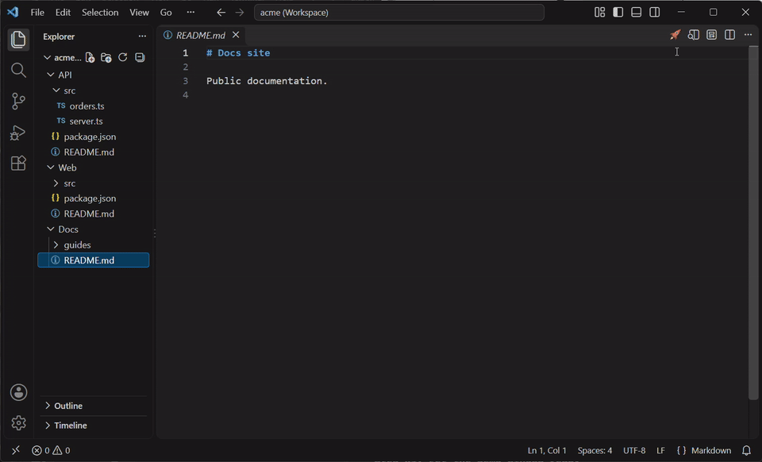
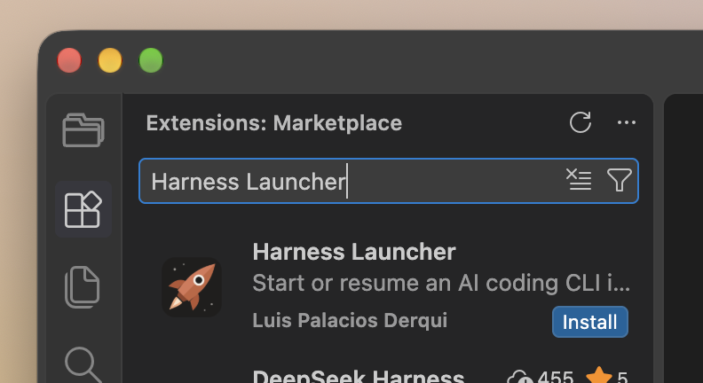
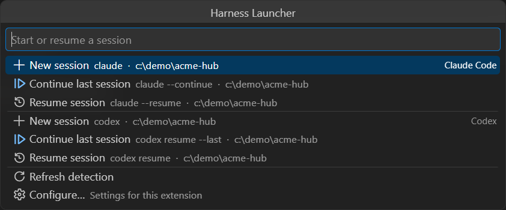

<p align="center">
  
</p>

<h1 align="center">Harness Launcher</h1>

<p align="center">
  <strong>One button to start or resume any AI coding CLI, in exactly the folder you choose.</strong><br>
  <em>A VS Code extension built for multi-root workspaces. It only lists the CLIs actually installed on the machine.</em>
</p>

<p align="center">
  <a href="https://github.com/LuisPalacios/harness-launcher/actions/workflows/ci.yml"></a>
  <a href="https://marketplace.visualstudio.com/items?itemName=luispa.harness-launcher"></a>
  <a href="https://marketplace.visualstudio.com/items?itemName=luispa.harness-launcher"></a>
  <a href="https://open-vsx.org/extension/luispa/harness-launcher"></a>
  <a href="https://open-vsx.org/extension/luispa/harness-launcher"></a>
  <a href="https://github.com/LuisPalacios/harness-launcher/releases/latest"></a>
  <a href="package.json"></a>
  <a href="LICENSE"></a>
</p>

One button in the editor title bar starts or resumes an AI coding CLI (a "harness") in a terminal, **in exactly the folder you choose**. It lists only the CLIs actually installed on the machine: Claude Code, Codex, Gemini CLI, GitHub Copilot CLI, opencode, plus any you add.



It is built for multi-root workspaces. Picture a hub folder holding a `.code-workspace` file, with several repository clones below it. The launcher starts every session **in the hub, never in one of the clones**, unless you tell it otherwise. Each hub can carry its own rule inside its `.code-workspace` file.

```text
── Claude Code ─────────────────────────────────────────────────
  + New session             claude                · ~/work/hub
  ▷ Continue last session   claude --continue     · ~/work/hub
  ↺ Resume session          claude --resume       · ~/work/hub
── Codex ───────────────────────────────────────────────────────
  + New session             codex                 · ~/work/hub
  ▷ Continue last session   codex resume --last   · ~/work/hub
  ↺ Resume session          codex resume          · ~/work/hub
────────────────────────────────────────────────────────────────
  ⟳ Refresh detection
  ⚙ Configure…
```

Every line shows the exact command and directory it uses. The terminal opens beside the current editor by default, with your normal shell profile, so your `PATH` and aliases apply.

## Why I built it

I work in VS Code with Claude Code running as a CLI in a terminal docked in the sidebar, instead of the extension's chat view. That way VS Code's own tools stay in the left panel (Explorer, Search, Source Control), and I still work with the harness the way I prefer: in its own terminal interface.

The weak spot is getting back in. When I close VS Code by accident, or the CLI session ends, I have to open a terminal, move to the right folder (the hub, not whichever clone was active), and remember that harness's resume flag. Harness Launcher turns all of that into one click on **Resume session**, in the right folder, with the right arguments, for every harness I use.

This is my setup in the user `settings.json`. Both settings belong to the Claude Code extension, which then runs the CLI in a terminal in the sidebar. Harness Launcher works the same with or without them.

```jsonc
{
  // Claude Code extension: open Claude in the sidebar, as the CLI in a terminal
  "claudeCode.preferredLocation": "sidebar",
  "claudeCode.useTerminal": true
}
```

## Install

Before you start, make sure you have:

- VS Code 1.93 or later, or a compatible editor such as VSCodium or Cursor.
- At least one harness CLI installed and working in a terminal, for example `claude --version` or `codex --version`. The extension launches these CLIs; it does not install them.

Then install the extension in one of these ways:

- **Extensions view (recommended):** press `Ctrl+Shift+X` (`Cmd+Shift+X` on macOS), search for **Harness Launcher**, and click **Install** on the entry with the rocket icon, published by **luispa**.

  <p align="center">
    
  </p>

- **Command line:**

  ```bash
  code --install-extension luispa.harness-launcher
  ```

- **VSCodium, Cursor and other forks:** the same extension is on [Open VSX](https://open-vsx.org/extension/luispa/harness-launcher), so their Extensions view finds it with the same search.
- **Offline, from a file:** download the `.vsix` from the [latest release](https://github.com/LuisPalacios/harness-launcher/releases/latest), then run **Extensions: Install from VSIX…** from the Command Palette.

To check it worked, open any file: the rocket appears at the right end of the editor tab row. Click it, and the list shows every harness it detected. If a CLI you installed is missing, see [Troubleshooting](#troubleshooting).

The extension activates after VS Code finishes starting, only to show its status bar button. It does not look for CLIs until you open the launcher, so it adds nothing to VS Code's startup time.

## Use

1. Click the rocket in the status bar, at the bottom right of the window. With a file open, the same rocket also sits at the right end of the editor's tab row (or in the row's **`…`** menu when it is crowded).
2. Pick an action under a harness:
   - **New session** starts a fresh session.
   - **Continue last session** jumps straight into the most recent session.
   - **Resume session** opens the CLI's own picker of past sessions.

<p align="center">
  
</p>

Run **Harness Launcher: Open Launcher** from the Command Palette to do the same without the mouse.

To skip the list for the harness I use most, I pick it in `harnessLauncher.quickLaunch.harness`. A double-click on either rocket then starts a **New session** of that harness straight away. A single click still opens the list, a moment later, so a second click has time to arrive.

**Continue last session** appears only when the CLI has a separate way to do it. For Gemini CLI and opencode, **Resume session** already opens the latest session, so the launcher shows no duplicate item. To hide the status bar button, turn off `harnessLauncher.statusBar.enabled`.

To bind a key directly to one action, add this to `keybindings.json`:

```json
{
  "key": "ctrl+alt+r",
  "command": "harnessLauncher.launch",
  "args": { "harness": "claude", "action": "resume" }
}
```

`harness` is a harness id from the table below (or a custom one), and `action` is `new`, `continue` or `resume`.

## Built-in harnesses

| Id         | Name           | Command    | Continue arguments                    | Resume arguments                        | Checked                         |
| ---------- | -------------- | ---------- | ------------------------------------- | --------------------------------------- | ------------------------------- |
| `claude`   | Claude Code    | `claude`   | `--continue` (most recent session)    | `--resume` (session picker)             | Verified on 2.1.304             |
| `codex`    | Codex          | `codex`    | `resume --last` (most recent session) | `resume` (session picker)               | Verified on 0.160.1             |
| `gemini`   | Gemini CLI     | `gemini`   | same as Resume, not shown             | `--resume latest` (most recent session) | Verified on 0.38.2              |
| `copilot`  | GitHub Copilot | `copilot`  | `--continue` (most recent session)    | `--resume` (session picker)             | From the official docs, not run |
| `opencode` | opencode       | `opencode` | same as Resume, not shown             | `--continue` (last session)             | From the official docs, not run |

New sessions run the bare command. Change any command or argument from the Settings UI.

**Detection.** A harness shows up only when its command is on `PATH` **and** `<command> --version` prints a version number within 3 seconds. Being found on `PATH` is not enough: some editors install a stub named after a CLI that prints "not installed" and exits successfully. On macOS and Linux, a command missing from `PATH` is also looked up in `~/.local/bin`, `/opt/homebrew/bin` and `/usr/local/bin`, because VS Code started from the Dock or a desktop launcher can miss folders that only the shell profile adds. To list a harness anyway, set its **Enabled** setting to `always`. A harness that was not found is checked again every time the launcher opens; after updating a CLI that was found, click **Refresh detection**.

## Settings

Open **Harness Launcher: Configure** or search `@ext:luispa.harness-launcher` in Settings. Every setting below is editable in the Settings UI, except `customHarnesses`.

| Setting                               | Default             | Description                                                                                                                           |
| ------------------------------------- | ------------------- | ------------------------------------------------------------------------------------------------------------------------------------- |
| `harnessLauncher.cwd.mode`            | `workspaceFile`     | Where the terminal starts. See [Working directory](#working-directory).                                                               |
| `harnessLauncher.cwd.folderName`      | `""`                | Folder for `namedFolder` mode: the name the Explorer shows, not the folder name on disk.                                              |
| `harnessLauncher.cwd.path`            | `""`                | Absolute path for `path` mode. Supports `~`, `${userHome}`, `${workspaceFileDir}`, `${workspaceFolder}`, `${workspaceFolder:<name>}`. |
| `harnessLauncher.terminal.location`   | `editorBeside`      | `editorBeside`, `editor` or `panel`.                                                                                                  |
| `harnessLauncher.statusBar.enabled`   | `true`              | Show the rocket button in the status bar.                                                                                             |
| `harnessLauncher.quickLaunch.harness` | `none`              | Harness whose **New session** starts on a double-click of a rocket button.                                                            |
| `harnessLauncher.<id>.enabled`        | `auto`              | `auto` (when detected), `always` or `never`.                                                                                          |
| `harnessLauncher.<id>.command`        | the CLI name        | Executable name on `PATH`, or an absolute path.                                                                                       |
| `harnessLauncher.<id>.newArgs`        | `""`                | Arguments for **New session**.                                                                                                        |
| `harnessLauncher.<id>.continueArgs`   | see the table above | Arguments for **Continue last session**. The item is hidden when they match New or Resume.                                            |
| `harnessLauncher.<id>.resumeArgs`     | see the table above | Arguments for **Resume session**.                                                                                                     |
| `harnessLauncher.customHarnesses`     | `[]`                | Extra harnesses, edited in `settings.json`.                                                                                           |

Arguments are one string, split like a shell would: separate them with spaces and group with `"double"` or `'single'` quotes. The launcher passes each argument quoted, never as raw shell text.

Add a CLI that is not built in with `customHarnesses`. An entry with a built-in `id` replaces that harness.

```json
"harnessLauncher.customHarnesses": [
  { "id": "aider", "label": "Aider", "command": "aider", "newArgs": "", "resumeArgs": "--restore-chat-history" }
]
```

## Working directory

`harnessLauncher.cwd.mode` decides where every terminal starts:

| Mode            | Directory                                                         |
| --------------- | ----------------------------------------------------------------- |
| `workspaceFile` | The folder that holds the saved `.code-workspace` file: the hub.  |
| `namedFolder`   | The workspace folder whose Explorer name equals `cwd.folderName`. |
| `firstFolder`   | The first workspace folder.                                       |
| `activeFile`    | The workspace folder of the file in the active editor.            |
| `pick`          | Ask each time: the hub or any workspace folder.                   |
| `path`          | The absolute path in `cwd.path`.                                  |

When a mode cannot resolve, for example `workspaceFile` in a single-folder window, the terminal starts in the first workspace folder, then in your home folder. A warning names the mode that failed, once per session.

## Multi-root hubs

**How do I give each hub its own rule?** Open Settings, select the **Workspace** tab, and set `cwd.mode` there. In a multi-root workspace, VS Code stores workspace settings inside the `.code-workspace` file:

```json
{
  "folders": [
    { "name": "API", "path": "api-service" },
    { "name": "Web", "path": "web-app" }
  ],
  "settings": {
    "harnessLauncher.cwd.mode": "namedFolder",
    "harnessLauncher.cwd.folderName": "API"
  }
}
```

**Why does `namedFolder` ignore my folder name?** It matches the `name` the Explorer shows (`API` above), not the folder name on disk (`api-service`). The match is exact and case-sensitive. The warning lists the names it found.

**Why did the terminal start in a clone instead of the hub?** The window was opened as a folder, not from the `.code-workspace` file, or the workspace is untitled. Open it with **File → Open Workspace from File…**, or save it with **File → Save Workspace As…**.

## Workspace Trust

A repository could set `command` or arguments in its own `.vscode/settings.json` and get code run when you click. In an untrusted workspace (Restricted Mode), the launcher ignores workspace-level values of every command, argument and path setting, and uses only your user settings. Working-directory modes and the terminal location still follow the workspace.

## Troubleshooting

- **The button is missing.** The status bar rocket is always there unless `harnessLauncher.statusBar.enabled` is off. The tab row rocket only shows when a file is open.
- **A CLI is not detected.** Open **View → Output** and select **Harness Launcher**. The log shows each detection, the path it resolved, why it was rejected and the `PATH` the extension sees.
- **A CLI installed after VS Code started is not found.** The extension sees the `PATH` VS Code started with, plus the folders listed under [Detection](#built-in-harnesses). If the CLI lives elsewhere, set its `command` to the absolute path, or restart VS Code.
- **A `.ps1` command is not detected on Windows.** The probe runs `powershell.exe`, so the PowerShell execution policy applies. Set the harness to `always`, or point `command` at the `.exe`.

## Remote and containers

The extension runs where the workspace lives, so in Remote SSH, WSL or a dev container it detects CLIs and opens terminals on the remote side. I have not tested it remotely yet; reports are welcome.

## Development

```bash
bun install
bun run typecheck && bun run lint && bun run test
bun run test:integration    # VS Code on a multi-root fixture
bun run package             # harness-launcher-<version>.vsix
```

## License

[MIT](LICENSE).
